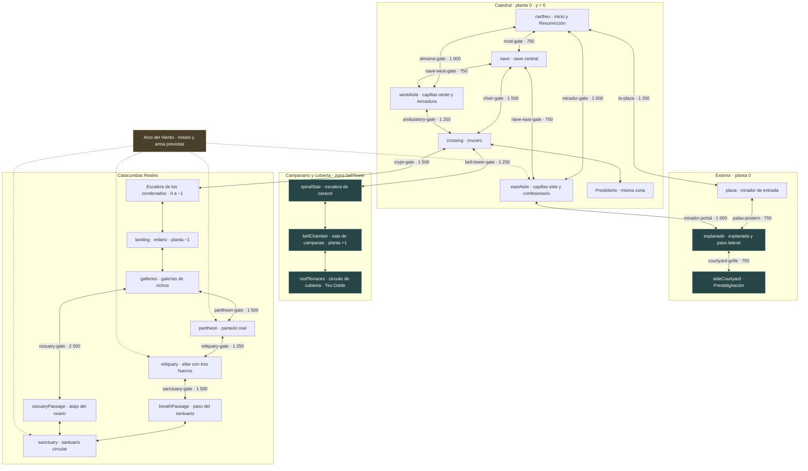
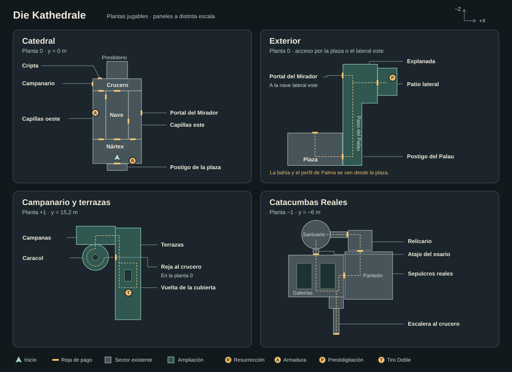

# Die Kathedrale · Topología jugable

El eje `X` crece hacia el este y `Z` hacia la plaza. Las cotas son alturas
de los pies en metros, salvo la posición de aparición y las coordenadas de
interacción. El jugador aparece en el nártex, en `(0, 1.72, -3.6)` (altura
de ojos). Las rejas se compran con puntos y quedan abiertas en ambos sentidos
hasta reiniciar. Al abrir una zona se activan sus entradas de zombis.

## Conexiones

Las líneas continuas son pasos físicos. Los enlaces discontinuos señalan
lugares reservados para una misión futura. El circuito exterior une el
postigo principal, la plaza, el paso del Palau, la explanada y el portal del
Mirador con la nave lateral este, que vuelve al nártex. La escalera del
crucero enlaza con la sala de campanas y las terrazas. La vuelta a la nave
se hace por el mismo caracol.

## Planta esquemática

Las líneas de reja en el esquema corresponden a las conexiones de pago del
grafo. Cada panel mantiene los mismos sentidos de los ejes y usa su propia
escala.

## Anillos

| Anillo | Posición de interacción `(x, y, z)` | Sector | Coste mínimo de rejas desde el inicio | Motivo |
| --- | --- | --- | ---: | --- |
| Resurrección | `(8.9, 1.16, -1.6)` | `narthex-funerary-alcove` · `narthex` | 0 | A un lado del inicio, bajo techo y visible sin comprar una reja. |
| Armadura | `(-12.6, 1.16, -29.3)` | `chapel-west-4` · `westAisle` | 1 000 | La Almoina abre una ruta temprana por las capillas. |
| Prestidigitación | `(39.7, 1.16, -28.1)` | Nicho del patio `sideCourtyard` | 2 750 | El trayecto más barato compra Mirador, portal y reja del patio. La vuelta tiene dos opciones tras completar el circuito exterior. |
| Tiro Doble | `(-10.5, 16.36, -35.8)` | `roofTerraces` · `bellTower`, planta +1 | 3 500 | Se llega por trascoro y coro, o por Almoina y deambulatorio, más la reja del campanario. |

El coste de la tabla cuenta las rejas necesarias para llegar a cada pedestal.
Los precios de compra y recarga de los anillos se mantienen en el
[catálogo compartido](../../src/game/rings/RingCatalog.ts).

La ruta transitable más corta en una malla cardinal de 0,25 m y con las
rejas de cada recorrido abiertas mide aproximadamente 9,25 m hasta
Resurrección, 40,25 m hasta Armadura y 69,25 m hasta Prestidigitación por el
Mirador. Por el Palau son 94,25 m. El trayecto por el Mirador atraviesa una
nave lateral estrecha. La vuelta por el Palau pasa por la plaza, que tiene
dos entradas de la horda. Los dos recorridos de coste mínimo a Tiro Doble
miden unos 143 m al combinar la malla cardinal con el eje del caracol
entre los rellanos. El nicho queda tras el aljibe, separado de la entrada
de servicio de la cubierta.

## Navegación y contenido reservado

- Planta 0: el nártex, la nave, las capillas, el crucero y el presbiterio
  comparten planta con la plaza existente y el exterior añadido. El
  presbiterio y el crucero pertenecen al mismo sector de progresión.
  Los peldaños del paso del Palau suben a un rellano de 0,24 m y vuelven
  al nivel de la plaza y la explanada.
  Las entradas añadidas de la horda son la puerta ruinosa al norte de la
  explanada (`mirador-ruined-gate`) y la reja este del patio
  (`courtyard-dark-gate`).
- Planta +1: la sala de campanas y las terrazas pertenecen al sector
  `bellTower`, a `y = 15.2`. El caracol se recorre desde el crucero y
  cambia de planta al llegar al otro extremo. Su eje recorre unos 61 m
  de pendiente, más los rellanos. Un arco sobre la antigua pared del
  crucero conecta los dos tramos de terraza y deja la reja de la cripta
  en la planta baja. Las dos entradas de la horda
  están en el oeste de la sala (`bell-loft-door`) y en un acceso de
  servicio de la cubierta (`roof-rood-door`).
- Planta −1, `y = −6`: el rellano desemboca en las galerías de nichos. El
  panteón, el relicario y el santuario forman un circuito con el osario.
  Se conservan la escalera, las rejas y las entradas de esta planta.
- El Arco del Viento tiene tres lugares reservados: el sepulcro este del
  panteón, el confesionario del lateral este y el pedestal del santuario.
  El altar del relicario está construido; el arma, sus piezas recogibles
  y su misión siguen previstos.
- KOVKA se encuentra en Station 33, al oeste de su subestación. Para entrar
  se abren las cocheras y la subestación, se restaura la electricidad y se
  compran la compuerta por 3 500 puntos y la mejora por 5 000. Die
  Kathedrale conserva su progresión independiente y Tiro Doble se puede
  comprar en la terraza sin pasar por la forja. [Cámara de KOVKA](../STATION_33.md#la-camara-kovka)

La horda usa una rejilla A* por planta. Para perseguir entre la cubierta y
las catacumbas encadena las escaleras pasando por la planta 0. En el
caracol, la altura de los pies distingue las vueltas superpuestas y la
dirección local conduce alrededor del pilar. Al cruzar el rellano, jugador
y zombis adoptan la planta de destino. Una reja comprada retira su
colisionador y actualiza la topología.

Los sectores y las ubicaciones de los anillos se mantienen en sus
configuraciones. [Catedral](../../src/zombies/maps/DieKathedraleConfig.ts) · [Exterior](../../src/zombies/maps/DieKathedraleExteriorConfig.ts) · [Campanario](../../src/zombies/maps/dieKathedrale/upper/UpperCathedralConfig.ts) · [Catacumbas](../../src/zombies/maps/DieKathedraleCatacombsConfig.ts) · [Anillos](../../src/zombies/maps/dieKathedrale/DieKathedraleRingSites.ts)
